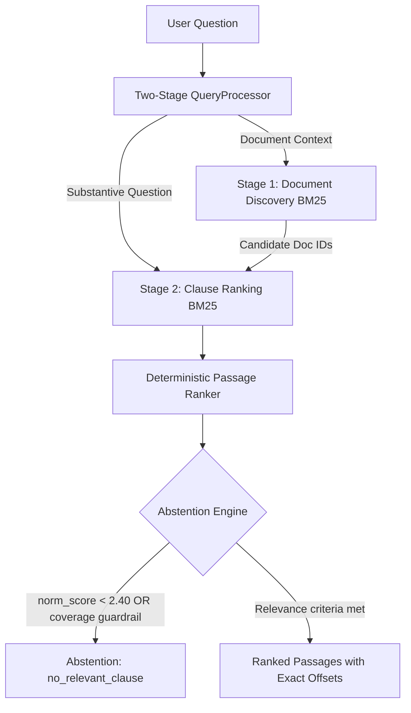

# JioStar Contract Intelligence Assistant
## Evidence-Based Contract Retrieval & Defensive Abstention Engine

A verifiable, reproducible information retrieval system that retrieves relevant contractual clauses from natural-language questions, extracts exact character-offset source evidence from commercial agreements, and defensively abstains when requested evidence is not present in the indexed corpus.

Hosted Repository: [https://github.com/Kunjdesai28/jiostar-contract-intelligence-assistant](https://github.com/Kunjdesai28/jiostar-contract-intelligence-assistant) (Public Repository)

---

## 1. Overview

The **JioStar Contract Intelligence Assistant** is an information retrieval system developed for the JioStar Data Science hiring assignment. Built upon the official **LegalBench-RAG CUAD** benchmark, it indexes 29 complex commercial agreements (SEC EDGAR filings) spanning 1,211,773 characters.

### Key Capabilities:
- **Natural-Language Querying**: Users submit questions through an interactive Streamlit web application or a scriptable Command-Line Interface (CLI).
- **Exact-Span Evidence Extraction**: Every returned passage provides exact `start_char` and `end_char` offsets pointing directly to the original contract file. Every passage strictly satisfies:
  $$\text{raw\_contract}[\text{start\_char}:\text{end\_char}] == \text{displayed\_passage}$$
- **Two-Stage Query Disambiguation**: Dynamically isolates agreement title preambles (`"Consider the Agreement between X and Y..."`) from substantive questions (`"What is the notice period for termination?"`), resolving contract-title matching bias.
- **Clause-Aware Structural Chunking**: Segments agreements along legal section boundaries (`1.1`, `Section 2`, `ARTICLE I`) rather than arbitrary character cuts, keeping contractual provisions intact.
- **Defensive Abstention**: Evaluates query-length normalized BM25 relevance scores and content coverage guardrails to return a clean `no_relevant_clause` signal when evidence is absent, rather than surfacing irrelevant text.
- **100% Local Execution**: All indexing, tokenization, stemming, retrieval, and abstention run entirely locally on CPU without external API calls or third-party cloud dependencies.

> **Important Scope Notice**: This system is a lexical clause retrieval and evidence extraction assistant. It does not provide legal advice, does not guarantee statutory compliance, and does not generate automated legal conclusions.

For complete numerical evaluation results, baseline comparisons, and iteration history, see [`REPORT.md`](REPORT.md).

---

## 2. Setup Guide

### 2.1 Prerequisites
- **Python Version**: Python 3.11 is required and verified (`3.11.9` tested).
- **Git**: Installed and accessible from your terminal.
- **Network Access**: Required only for initial dataset download from Hugging Face. Subsequent indexing, evaluation, CLI queries, and Streamlit runs execute 100% offline.
- **API Keys**: **None**. The system does not call external LLMs or cloud endpoints; no API keys or `.env` secrets are required.

### 2.2 Fresh Clone & Environment Installation

#### On Windows (PowerShell):
```powershell
# 1. Clone repository
git clone https://github.com/Kunjdesai28/jiostar-contract-intelligence-assistant.git
cd jiostar-contract-intelligence-assistant

# 2. If PowerShell script execution is restricted, enable process-level execution:
Set-ExecutionPolicy -Scope Process -ExecutionPolicy Bypass

# 3. Create virtual environment with Python 3.11
py -3.11 -m venv .venv

# 4. Activate virtual environment
.\.venv\Scripts\Activate.ps1

# 5. Install dependencies
pip install --upgrade pip
pip install -r requirements.txt
```

#### On Linux / macOS (bash):
```bash
# 1. Clone repository
git clone https://github.com/Kunjdesai28/jiostar-contract-intelligence-assistant.git
cd jiostar-contract-intelligence-assistant

# 2. Create virtual environment
python3.11 -m venv .venv

# 3. Activate virtual environment
source .venv/bin/activate

# 4. Install dependencies
pip install --upgrade pip
pip install -r requirements.txt
```

### 2.3 Dataset Acquisition & Preparation

The raw CUAD benchmark contracts are downloaded directly from the official pinned Hugging Face repository and processed deterministically:

```bash
# Step 1: Download raw CUAD corpus & benchmark from Hugging Face (commit 2b9c248b)
python scripts/download_dataset.py

# Step 2: Prepare deterministic 194-query mini-benchmark and 32 frozen negatives
python scripts/prepare_dataset.py

# Step 3: Validate gold character spans and dataset invariants
python scripts/validate_dataset.py

# Step 4: Build the clause-aware BM25 retrieval index
python scripts/build_index.py --force
```

---

## 3. How to Run

### 3.1 Streamlit Web Application
Launch the interactive web interface:
```bash
streamlit run app/streamlit_app.py
```
Open your browser to `http://localhost:8501`. The web application defaults to the final production pipeline (`configs/final.yaml`) with full abstention controls, top-$K$ selection, and exact character offset displays.

### 3.2 Command-Line Interface (CLI)
The CLI supports human-readable text and machine-readable JSON output:

```bash
# Standard legal clause query
python cli.py search --query "What is the governing law of this agreement?" --top-k 5 --config configs/final.yaml

# JSON output mode (ideal for integration pipelines)
python cli.py search --query "What is the termination notice period?" --top-k 3 --format json --config configs/final.yaml

# Benchmark-style query with contract preamble
python cli.py search --query "Consider the Amendment No. 3 to Wireless Content License Agreement between Fox Mobile Entertainment, Inc. and Glu Mobile Inc.; What is the expiration date of this contract?" --top-k 1 --config configs/final.yaml

# Unsupported out-of-domain query triggering abstention
python cli.py search --query "What is the average annual rainfall in the Amazon rainforest basin?" --config configs/final.yaml
```

### 3.3 Index & Evaluation Commands
```bash
# Rebuild the retrieval index
python scripts/build_index.py --force

# Run training split evaluation on final configuration (saves to custom output path to protect baseline metrics)
python scripts/evaluate_baseline.py --config configs/final.yaml --split train --output experiments/reproduced_final_train.json

# Run full automated regression test suite
python -m pytest -v

# Run submission readiness verification script
python scripts/verify_submission.py
```

> **Evaluation Semantics Note**: `evaluate_baseline.py` measures raw candidate retrieval (pre-abstention Recall@5 = 0.3191, matching the Phase 3 winning candidate). When end-to-end calibrated abstention ($\ge 2.40$) is applied, the frozen Phase 4 final training Recall@5 is 0.3096 (due to 5 false abstentions on answerable queries in exchange for rejecting 52.6% of unanswerable queries).

### 3.4 Automated Self-Improvement Loop
The project includes an automated self-improvement runner (`scripts/run_improvement_loop.py`) that diagnoses errors, proposes configurations, and evaluates candidates under frozen guardrails.

**Automated Overwrite Protection**:
By default, `scripts/run_improvement_loop.py` writes safely to non-destructive replay destinations:
- Log: `experiments/replay_log.jsonl`
- Summary: `experiments/replay_summary.json`
- Final config: `configs/replay_final.yaml`

Frozen submission artifacts (`configs/final.yaml`, `experiments/improvement_log.jsonl`, etc.) are actively protected from accidental overwrite via canonical path resolution checks. Reviewers can safely replay the 5 genuine iterations using a single command:
```bash
python scripts/run_improvement_loop.py
```

---

## 4. System Architecture

The selected retrieval pipeline (`candidate_final_phase4`, configuration: [`configs/final.yaml`](configs/final.yaml)) operates deterministically:



### Pipeline Components & Configuration Locations:
- **Two-Stage Query Processing (`src/retrieval/query_processor.py`)**: Uses regex boundary parsing to split query preambles from substantive questions.
- **Clause-Aware Chunking (`src/indexing/chunker.py`)**: Segments text along legal headings (`chunk_size: 1000`, `overlap: 250`).
- **Legal Morphological Tokenization (`src/retrieval/lexical_enhancement.py`)**: Suffix normalization protecting statutory modals (`shall`, `may`, `must`, `not`, `exclusive`).
- **BM25 Retrieval Engine (`src/retrieval/bm25.py`)**: Rank-BM25 Okapi implementation ($k_1=1.5, b=0.75$).
- **Abstention Engine (`src/retrieval/abstention.py`)**: Combines query-length normalized BM25 relevance with an evidence coverage guardrail.
- **Pipeline Configurations**:
  - Baseline configuration: [`configs/baseline.yaml`](configs/baseline.yaml)
  - Phase 3 winner: [`configs/final_phase3.yaml`](configs/final_phase3.yaml)
  - Frozen final configuration: [`configs/final.yaml`](configs/final.yaml)

---

## 5. Step-by-Step Reproduction Guide

To independently reproduce the reported results from a fresh clone:

| Step | Action & Command | Target Artifact / Verification | Approx. Duration |
|:---:|:---|:---|:---:|
| **1** | Download CUAD data: `python scripts/download_dataset.py` | 463 files under `data/raw/` | ~15–30s |
| **2** | Prepare benchmark: `python scripts/prepare_dataset.py` | `data/processed/` manifests and queries | ~3s |
| **3** | Validate gold spans: `python scripts/validate_dataset.py` | Confirms 272/272 spans match raw text | ~1s |
| **4** | Build retrieval index: `python scripts/build_index.py --force` | 1,991 chunks indexed from 29 contracts | ~2s |
| **5** | Evaluate baseline train: `python scripts/evaluate_baseline.py --config configs/baseline.yaml --split train` | Confirms baseline Rec@5 = 0.1169 | ~4s |
| **6** | Evaluate final train: `python scripts/evaluate_baseline.py --config configs/final.yaml --split train --output experiments/reproduced_final_train.json` | Confirms candidate retrieval Rec@5 = 0.3191 (Phase 3 selected). Calibrated abstention shifts end-to-end frozen Phase 4 train Rec@5 to 0.3096 while rejecting 10/19 (52.6%) unanswerable queries. | ~9s |
| **7** | Run unit tests: `python -m pytest -v` | All tests pass | ~2s |
| **8** | Safe improvement loop replay: `python scripts/run_improvement_loop.py` | Replays 5 iterations (4 accepted, 1 rejected) safely to replay destinations without modifying frozen artifacts | ~25s |
| **9** | Inspect official held-out test results: `python -c "import json; print(json.dumps(json.load(open('experiments/final_test_metrics.json')), indent=2))"` | Inspects official test result artifact | < 1s |
| **10**| Verify submission integrity: `python scripts/verify_submission.py` | 7/7 integrity checks pass | ~1s |

### Scientific Context: Phase 3 Candidate vs. Phase 4 Frozen Final Training Recall
- **Phase 3 Selected Candidate (`candidate_005`)**: Evaluated with abstention threshold set to 0.0 (raw candidate retrieval without abstention filtering). Achieved training character **Recall@5 = 0.3191** on the 140 answerable training queries.
- **Phase 4 Frozen Final Pipeline (`configs/final.yaml`)**: Calibrated abstention was activated with normalized BM25 score threshold $\ge 2.40$ and coverage guardrails. This rejected **10 out of 19 (52.6%)** unanswerable training queries, while falsely abstaining on **5 out of 140 (3.6%)** positive training queries.
- **Trade-off Analysis**: Sacrificing 2.97% retrieval recall across those 5 borderline answerable queries gained a 52.6% defensive rejection rate on unsupported/unanswerable queries. Setting recall to 0.0 for those 5 queries shifted the macro-average training Recall@5 from **0.3191** to **0.3096**, strictly respecting the pre-declared $\le 5\%$ allowable degradation guardrail (floor: 0.3031).
- **Evaluation Command Mapping**:
  - `python scripts/evaluate_baseline.py --config configs/final.yaml --split train --output experiments/reproduced_final_train.json` evaluates `search_candidates()`, reporting raw candidate **Recall@5 = 0.3191**, along with the separate abstention breakdown (10/19 negative rejections, 5/140 false positive abstentions).
  - The end-to-end pipeline with abstention filtering produces macro-averaged **Recall@5 = 0.3096** as documented in [`REPORT.md`](REPORT.md#53-mandatory-investigation-2-phase-3-vs-phase-4-training-recall) and [`docs/PHASE4_FREEZE.md`](docs/PHASE4_FREEZE.md).

### Held-Out Evaluation Protection Notice:
In accordance with strict scientific evaluation protocols, `scripts/final_evaluation.py` was executed **exactly once** on the held-out test set (54 answerable + 13 unanswerable queries). The script contains an automated guardrail that aborts execution if `experiments/final_test_metrics.json` already exists. Reviewers should inspect the committed artifact (Step 9) rather than re-running the held-out evaluation.

---

## 6. Assumptions and Design Decisions

1. **CUAD Mini-Benchmark Selection**: To enable rapid, reproducible experimentation while preserving statistical significance, 194 queries across 29 diverse SEC EDGAR contracts were selected deterministically from the 4,042 CUAD queries.
2. **Restricted Indexing Scope**: The retrieval collection indexes the 29 contracts associated with the selected benchmark queries (1,211,773 characters). Unreferenced CUAD contracts are excluded to maintain clean corpus boundaries.
3. **Deterministic Splitting**: Train and test partitions (140 train / 54 test) were generated using a deterministic SHA-256 hash on normalized query text.
4. **Frozen Unanswerable Negatives**: 32 negative queries (19 train / 13 test) across 6 categories were created and frozen with SHA-256 `7eaf304f4a22a4567100fb283a53f1bfc7b458eaa2f7feb7d78ba66db3d539d3`.
5. **Character-Level Metrics**: Because legal clauses vary in length, retrieval quality is measured at the character level rather than token or document level, matching the LegalBench-RAG evaluation standard.
6. **Zero-Indexing Character Offsets**: Character spans use Python slice semantics $[start:end]$, where index 0 is the first UTF-8 character of the contract.
7. **Multiple Gold Spans**: Queries with multiple gold answer spans merge overlapping characters within the same document to prevent artificial metric inflation.
8. **Overlapping Retrieved Passages**: Overlapping retrieved chunks in the same agreement are merged into a single character set before precision/recall calculation.
9. **Macro Aggregation**: Precision@$K$ and Recall@$K$ are averaged macro-wise across queries, giving equal weight to every legal question regardless of answer span length.
10. **Abstention Interpretation**: When the system abstains, it returns an empty passage list and status `no_relevant_clause`. An abstained answerable query receives 0.0 recall and precision.
11. **Free-Form Queries Without Preamble**: Queries lacking contract titles search the global collection across all 29 contracts.
12. **Offline Local Inference**: The runtime pipeline avoids external LLMs to ensure determinism, zero data leakage for confidential contracts, low latency (~27 ms), and exact substring offsets.

---

## 7. AI Tool Usage Disclosure

- **Development Assistance**: Google DeepMind's Antigravity assistant was employed as a pair-programming and developer-assistance tool during development. Its contributions included drafting boilerplate code, suggesting test cases, refactoring modules, formatting markdown documentation, and running local terminal commands under continuous human review.
- **Runtime Inference**: The submitted retrieval engine does **not** employ an LLM at runtime. All indexing, stemming, retrieval, ranking, and abstention decisions are executed locally by deterministic Python algorithms. No LLM API key is required.

---

## 8. Summary of Performance and Documentation

For detailed performance tables, baseline comparisons, self-improvement loop iteration details, 10 concrete failure analyses, and limitations, please consult:

- **[`REPORT.md`](REPORT.md)**: Main technical report and comprehensive submission documentation.
- **[`docs/FINAL_EVALUATION.md`](docs/FINAL_EVALUATION.md)**: Full experimental evaluation and audit report.
- **[`docs/PHASE4_FREEZE.md`](docs/PHASE4_FREEZE.md)**: Cryptographic freeze manifest.
- **[`experiments/final_test_metrics.json`](experiments/final_test_metrics.json)**: Official held-out test evaluation results.
