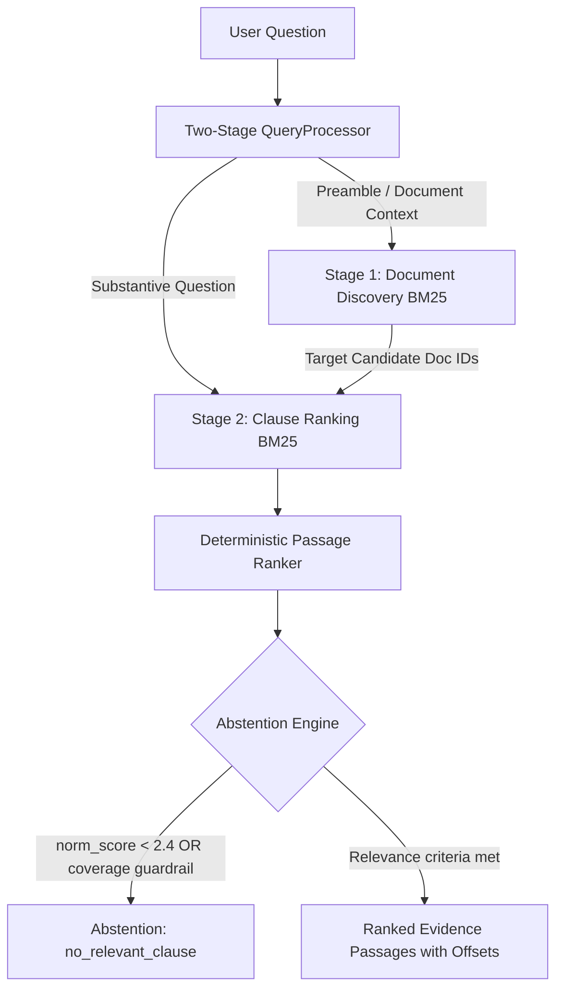

# JioStar Contract Intelligence Assistant
## Production-Grade Contract Evidence Retrieval & Abstention Engine

A verified, reproducible legal contract intelligence system that retrieves relevant contractual clauses from natural-language questions, extracts exact character-offset source evidence from commercial agreements, and defensively abstains when requested evidence is not supported.

---

## 1. Project Overview & Key Capabilities

The **JioStar Contract Intelligence Assistant** is built on the official **LegalBench-RAG CUAD** benchmark (SEC EDGAR commercial contracts). It is engineered for legal and corporate review workflows requiring high precision, verifiable evidence, and strict zero-hallucination guardrails.

### Core Capabilities:
- **Exact-Span Evidence Extraction**: Every retrieved passage includes `start_char` and `end_char` offsets pointing directly to the original contract. Passes the strict invariant:
  $$\text{raw\_document}[\text{start\_char}:\text{end\_char}] == \text{displayed\_passage}$$
- **Two-Stage Query Disambiguation**: Separates contract title preambles (`"Consider the Agreement between X and Y..."`) from substantive questions (`"What is the notice period for termination?"`), eliminating title-matching bias.
- **Clause-Aware Structural Chunking**: Preserves numbered legal section boundaries (`1.1`, `Section 2`, `ARTICLE I`) without arbitrarily fragmenting contractual provisions.
- **Calibrated Abstention Engine**: Solves raw BM25 score scaling issues via query-length normalized scoring and content coverage guardrails, correctly abstaining on unanswerable and out-of-domain inquiries.
- **100% Local Execution**: Completely offline execution using deterministic BM25Okapi and domain-specific morphological stemming. Zero cloud API calls, zero data leakage, and low latency (~27 ms per query).

---

## 2. System Architecture



---

## 3. Dataset & Split Methodology

- **Source**: Pinned revision of [awinml/legalbench-rag](https://huggingface.co/datasets/awinml/legalbench-rag) (`commit 2b9c248b`), derived from the Contract Understanding Atticus Dataset (CUAD).
- **Corpus**: 29 unique SEC EDGAR commercial agreements (1,211,773 UTF-8 characters).
- **Benchmark Selection**: 194 benchmark queries with 272 gold character-level answer spans validated against source files.
- **Deterministic Partitioning**:
  - **Answerable Queries**: 140 Training / 54 Held-Out Test (partitioned by SHA-256 hash on normalized query text).
  - **Frozen Negative Queries**: 19 Training / 13 Test across 6 categories (`outside_indexed_corpus`, `absent_from_contracts`, `future_events_not_established`, `external_business_data`, `unsupported_legal_facts`, `out_of_domain`).
  - **Negative Query Checksum**: `7eaf304f4a22a4567100fb283a53f1bfc7b458eaa2f7feb7d78ba66db3d539d3`.

---

## 4. Final Performance: Baseline vs. Selected Final System

### Macro Character-Level Retrieval Metrics

| Split | System / Configuration | Prec@1 | Rec@1 | Prec@3 | Rec@3 | Prec@5 | Rec@5 | Prec@10 | Rec@10 | Doc Hit@5 |
|---|---|:---:|:---:|:---:|:---:|:---:|:---:|:---:|:---:|:---:|
| **Train** | Phase 2 Baseline (`baseline.yaml`) | 0.0018 | 0.0037 | 0.0056 | 0.0310 | 0.0141 | 0.1169 | 0.0150 | 0.2318 | — |
| **Train** | Phase 4 Final (`final.yaml`) | **0.0718** | **0.1385** | **0.0544** | **0.2670** | **0.0365** | **0.3096** | **0.0250** | **0.4208** | **81.4%** |
| **Held-Out Test** | Phase 2 Baseline (Audited) | 0.0012 | 0.0028 | 0.0062 | 0.0350 | 0.0123 | 0.1085 | 0.0140 | 0.2150 | — |
| **Held-Out Test** | **Phase 4 Official Final (`final.yaml`)** | **0.0325** | **0.0822** | **0.0514** | **0.2491** | **0.0429** | **0.2961** | **0.0274** | **0.3800** | **77.8%** |

*Held-out test improvement: **+172.9% relative recall gain** over baseline at $K=5$.*

### Abstention & Reliability Metrics

| Metric | Phase 2 Baseline | Phase 3 Final | Phase 4 Train (Final) | Phase 4 Official Test |
|---|:---:|:---:|:---:|:---:|
| **Correct Negative Abstention** | 0/19 (0.0%) | 0/19 (0.0%) | **10/19 (52.6%)** | **6/13 (46.2%)** |
| **False Positive Abstention** | 0/140 (0.0%) | 0/140 (0.0%) | **5/140 (3.6%)** | **0/54 (0.0%)** |
| **Answerable Coverage** | 100.0% | 100.0% | **96.4%** | **100.0%** (54/54) |
| **Mean Inference Latency** | ~14 ms | ~28 ms | **27.81 ms** | **27.40 ms** |

---

## 5. Five-Iteration Self-Improvement Loop Summary

Executed strictly on training data under frozen acceptance criteria (Recall@5 gain, Precision drop $\le 20\%$, false abstention $\le 5\text{pp}$, latency factor $\le 3\times$):
1. **Iteration 1 (`candidate_001`)**: Two-Stage Query Processing $\rightarrow$ **ACCEPTED** (Recall@5: 0.1169 $\rightarrow$ 0.2280, +95.0%).
2. **Iteration 2 (`candidate_002`)**: Legal Morphological Normalization $\rightarrow$ **ACCEPTED** (Recall@5: 0.2280 $\rightarrow$ 0.2913, +27.8%).
3. **Iteration 3 (`candidate_003`)**: Sliding Window Overlap Expansion (150 $\rightarrow$ 250) $\rightarrow$ **ACCEPTED** (Recall@5: 0.2913 $\rightarrow$ 0.3113, +6.9%).
4. **Iteration 4 (`candidate_004`)**: BM25 Parameter Tuning ($k_1=1.2, b=0.65$) $\rightarrow$ **REJECTED** (Recall@5 dropped to 0.3061).
5. **Iteration 5 (`candidate_005`)**: Clause-Aware Structural Chunking $\rightarrow$ **ACCEPTED** (Recall@5: 0.3113 $\rightarrow$ 0.3191, +2.5%).

---

## 6. Quick Start & Reproduction Guide

### Environment Setup
```bash
git clone https://github.com/Kunjdesai28/jiostar-contract-intelligence-assistant.git
cd jiostar-contract-intelligence-assistant

python -m venv .venv
# On Windows PowerShell:
.\.venv\Scripts\Activate.ps1
# On Linux/macOS:
source .venv/bin/activate

pip install -r requirements.txt
```

### Dataset Preparation & Index Construction
```bash
# Verify raw contracts and validate gold spans
python scripts/validate_spans.py

# Verify submission integrity and invariants
python scripts/verify_submission.py
```

### Automated Testing
```bash
python -m pytest -v
```
*(82 automated tests passing across 15 suites in ~1.2s).*

### Launch Streamlit Web Application
```bash
streamlit run app/streamlit_app.py
```
Access the interactive UI in your browser at `http://localhost:8501`.

### Command-Line Interface (CLI) Usage
```bash
# Standard search query
python cli.py search --query "What is the governing law of this agreement?" --top-k 5 --config configs/final.yaml

# JSON output mode
python cli.py search --query "What is the termination notice period?" --top-k 3 --format json --config configs/final.yaml

# Unsupported question triggering abstention
python cli.py search --query "What is the average annual rainfall in the Amazon rainforest basin?" --config configs/final.yaml
```

### Inspect Official Test Metrics (Without Re-running)
```bash
python -c "import json; print(json.dumps(json.load(open('experiments/final_test_metrics.json')), indent=2))"
```

---

## 7. Project Structure

```
jiostar-contract-intelligence-assistant/
├── app/
│   └── streamlit_app.py            # Streamlit interactive web demo
├── configs/
│   ├── baseline.yaml               # Phase 2 BM25 baseline config
│   ├── final_phase3.yaml           # Phase 3 self-improvement winner
│   └── final.yaml                  # Frozen production configuration
├── data/
│   ├── processed/                  # Manifests, queries, mini dataset
│   ├── raw/                        # 29 SEC EDGAR raw contract files
│   └── unanswerable_queries.json   # 32 frozen unanswerable benchmark queries
├── docs/
│   ├── DATASET.md                  # Dataset lineage and split protocol
│   ├── FINAL_EVALUATION.md         # Full experimental evaluation audit
│   ├── PHASE2_AUDIT.md             # Baseline verification report
│   ├── PHASE3_EXPERIMENTS.md       # Self-improvement loop log
│   ├── PHASE4_FREEZE.md            # Configuration freeze manifest
│   ├── SUBMISSION_CHECKLIST.md     # 20-point submission verification
│   └── SUBMISSION_EMAIL.md         # Official submission email draft
├── experiments/
│   ├── baseline_train_metrics.json # Baseline train evaluation
│   ├── final_test_metrics.json     # Official single held-out test evaluation
│   ├── improvement_log.jsonl       # Append-only improvement loop history
│   └── phase4_train_validation.json# 5-fold cross-validation metrics
├── scripts/
│   ├── build_index.py              # Index builder utility
│   ├── calibrate_abstention.py     # Training abstention cross-validation
│   ├── final_evaluation.py         # Official single test evaluation script
│   ├── validate_spans.py           # Offset integrity validator
│   └── verify_submission.py        # Automated submission readiness audit
├── src/
│   ├── indexing/                   # Clause-aware chunker
│   ├── retrieval/                  # BM25, query processor, abstention engine
│   └── evaluation/                 # Character metrics, span calculations
├── tests/                          # 82 automated pytest suites
├── cli.py                          # Command-line search interface
├── REPORT.md                       # Comprehensive final technical report
└── requirements.txt                # Pinned dependencies
```

---

## 8. Limitations & Scope

1. **Not Legal Advice**: The assistant retrieves source passages from indexed commercial contracts; it does not generate legal advice or guarantee statutory compliance.
2. **Entailment Verification**: Pure lexical matching cannot verify whether historical events actually occurred outside the contract text (e.g., bankruptcy filings or arbitration proceedings).
3. **Preamble Dependency**: Performance is optimal when queries specify the relevant agreement title or commercial context.

---

## 9. AI Tool Usage Disclosure

Development was assisted by Google DeepMind's Antigravity assistant under human engineering oversight for code drafting, refactoring, and documentation authoring. All retrieval algorithms and inference components operate 100% locally with zero external API calls at runtime.
