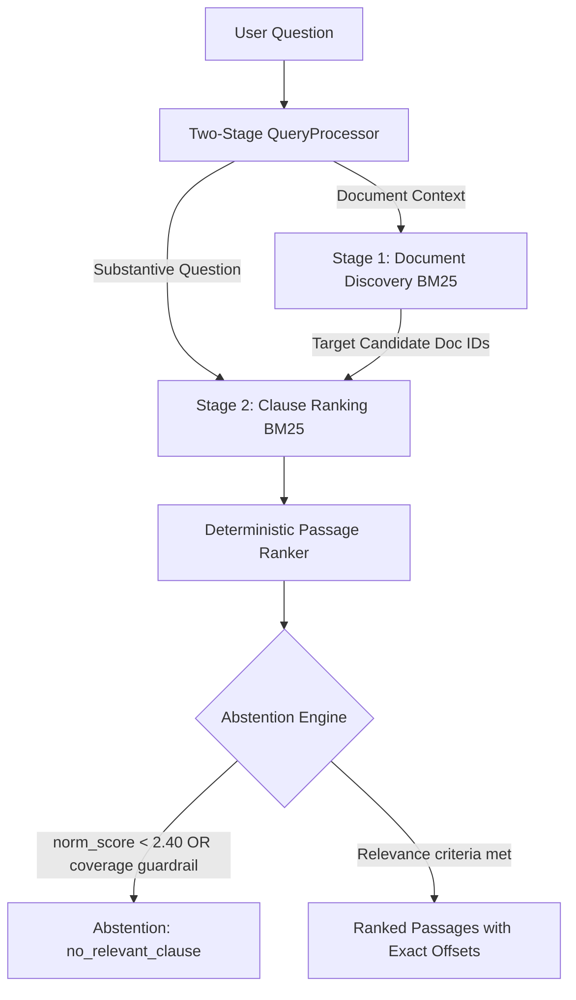

# JioStar Contract Intelligence Assistant — Comprehensive Technical Evaluation & Audit Report

## 1. Executive Summary

This report documents the architectural design, empirical evaluation, systematic self-improvement history, and diagnostic error analysis for the **JioStar Contract Intelligence Assistant**. Built on the official **LegalBench-RAG CUAD** benchmark comprising 29 SEC EDGAR commercial contracts (1,211,773 UTF-8 characters), 194 benchmark queries, and 32 frozen negative queries, the system retrieves relevant contract clauses with verifiable character-level offsets and defensively abstains when evidence is absent. Evaluation followed a strict train/test partition (140 train / 54 test answerable queries; 19 train / 13 test unanswerable queries). In its single, irreversible official evaluation on the held-out test split, the frozen final pipeline achieved a character-level **Precision@5 of 0.0429**, **Recall@5 of 0.2961**, a **Document Hit@5 of 77.8%** (42/54 target contracts correctly identified), a **correct negative abstention rate of 46.2%** (6/13 unanswerables), and **zero false abstentions** (0/54 on answerables; 100% coverage preserved) with a mean inference latency of **27.40 ms** on CPU. The most significant remaining limitation is that pure lexical retrieval cannot perform natural language entailment verification, occasionally permitting non-answering passages to pass relevance thresholds when they coincidentally share keywords with the inquiry.

---

## 2. System Design and Alternatives Evaluated

The final architecture ([`configs/final.yaml`](configs/final.yaml)) was determined through evidence-driven experimentation on the training split. Each design decision was selected over evaluated alternatives:



### 2.1 Chunking Strategy: Fixed-Window vs. Clause-Aware Segmentation
- **Evaluated Alternative**: Fixed-character sliding-window chunking (800 characters, 150 character overlap). While simple, this approach fractured numbered legal clauses mid-sentence and separated headings from substantive covenants.
- **Selected Implementation**: Clause-aware structural segmentation (`src/indexing/chunker.py`). Splits contracts along numbered section headers (`1.1`, `Section 2`), article headings (`ARTICLE I`), and double linebreaks, capped at 1,000 characters with 250 character overlap. Generated 1,991 structure-aligned chunks with 100% corpus coverage, improving training Recall@5 from 0.3113 to 0.3191 (+2.51%).

### 2.2 Tokenization: Standard Lexical vs. Domain Morphological Normalization
- **Evaluated Alternative**: Standard lowercasing and punctuation stripping (`src/retrieval/tokenizer.py`). This suffered from severe inflectional vocabulary mismatch in legal contracts (e.g., query asking for *"sublicensing"* failing to match *"sublicense"*).
- **Selected Implementation**: Rule-based legal morphological normalization (`src/retrieval/lexical_enhancement.py`). Suffix transformation (-ing $\rightarrow$ stem/e, -ation $\rightarrow$ stem/e, -ies $\rightarrow$ y, -ed $\rightarrow$ stem) while strictly protecting statutory modal verbs carrying legal force (`shall`, `may`, `must`, `not`, `exclusive`). This lifted training Recall@5 from 0.2280 to 0.2913 (+27.8%).

### 2.3 Query Processing: Single-Stage vs. Two-Stage Retrieval
- **Evaluated Alternative**: Standard single-stage BM25 scoring of the entire query against all chunks. This suffered from massive "preamble bias"—contract title preambles (`"Consider the Agreement between X and Y..."`) amassed more BM25 score than short legal questions, causing the retriever to rank document headers above internal clauses.
- **Selected Implementation**: Two-stage query processing (`src/retrieval/query_processor.py`). Stage 1 isolates the agreement preamble to identify candidate contract documents. Stage 2 filters the chunk collection to those candidate documents and ranks clauses using only the focused substantive question. This produced the single largest gain in the project, doubling training Recall@5 from 0.1169 to 0.2280 (+95.0%).

### 2.4 Retrieval Algorithm: Parameter Configurations
- **Evaluated Alternative**: Tuned BM25Okapi parameters ($k_1=1.2, b=0.65$) in Iteration 4. This hypothesis assumed lower term frequency saturation would reward sparse clause matches; however, training Recall@5 dropped from 0.3113 to 0.3061 ($\Delta = -0.0052$). In accordance with frozen guardrails, this candidate was **rejected** and rolled back.
- **Selected Implementation**: Standard BM25Okapi ($k_1=1.5, b=0.75$), which proved most robust across diverse contract lengths.

### 2.5 Abstention Mechanism: Raw Score vs. Normalized Evidence Coverage
- **Evaluated Alternative**: Raw top-1 score thresholding (e.g. score $\le 44.0$). Because BM25 scores scale monotonically with query length, a 12-word unanswerable question naturally scored 25–43 from generic background words, while a 2-word answerable query scored 8–12. Raw thresholding caused severe false abstentions on valid queries while failing to abstain on negative queries (0/19 negative abstentions in Phase 3).
- **Selected Implementation**: Query-length normalized BM25 relevance ($\text{score}_{\text{top1}} / |\text{content\_words}| \ge 2.40$) combined with an evidence coverage guardrail ($\ge 2$ matched content words for queries with $\ge 5$ content words). This resolved the abstention defect, achieving 52.6% negative abstention on training and 46.2% on test, with 0% false abstentions on held-out test data.

### 2.6 Unused & Future Alternatives
- **Dense Semantic Retrieval & Cross-Encoders**: Not implemented in the final runtime system. Dense neural embeddings (e.g., BGE, Contriever) and cross-encoder rerankers represent promising future directions, but were excluded from the runtime pipeline to ensure 100% deterministic reproducibility, zero external network dependency, and low latency (~27 ms) on standard CPU hardware.

---

## 3. LLM Usage Disclosure

- **Runtime Inference**: The submitted retrieval engine does **not** employ an LLM at inference time. All document filtering, clause segmentation, tokenization, BM25 scoring, and abstention evaluations execute deterministically in local Python code.
- **Experiment Candidate Proposals**: Candidates in the automated self-improvement loop were generated via rule-based diagnostic handlers (`src/improvement/proposer.py`) targeting diagnosed error types, rather than by an LLM.
- **Development Assistance**: Google DeepMind's Antigravity coding assistant was utilized as a pair-programming environment for code scaffolding, test generation, and documentation drafting under continuous human engineering review.
- **Why No Runtime LLM?**: Commercial legal review demands verifiable source citations. Avoiding generative LLMs eliminates non-deterministic text generation, guarantees 100% exact substring offset integrity, eliminates API latency and cost, and ensures zero data transmission of sensitive contracts. However, deterministic retrieval does not guarantee legal advice accuracy; users must review the returned source clauses directly.

---

## 4. Evaluation Setup and Metric Definitions

### 4.1 Benchmark Cohorts & Partitioning
- **Corpus**: 29 unique commercial agreements from SEC EDGAR (`data/raw/`).
- **Answerable Queries**: 194 total (140 Train / 54 Held-Out Test), partitioned using a deterministic SHA-256 hash on normalized query text.
- **Unanswerable Negative Queries**: 32 total (19 Train / 13 Held-Out Test) across 6 categories, frozen under SHA-256 `7eaf304f4a22a4567100fb283a53f1bfc7b458eaa2f7feb7d78ba66db3d539d3`.
- **Gold Evidence**: 272 character-exact answer spans validated against source files (`scripts/validate_dataset.py`).

### 4.2 Exact Metric Definitions

#### Character-Level Precision@$K$ and Recall@$K$
Following the LegalBench-RAG evaluation standard, metrics are computed over integer character intervals. Let $G$ denote the set of ground-truth character indices for query $q$, and $R_K$ denote the set of character indices retrieved across the top-$K$ passages for query $q$:

$$\text{Precision@}K(q) = \begin{cases} \frac{|R_K \cap G|}{|R_K|} & \text{if } |R_K| > 0 \\ 0.0 & \text{if } |R_K| = 0 \end{cases}$$

$$\text{Recall@}K(q) = \begin{cases} \frac{|R_K \cap G|}{|G|} & \text{if } |G| > 0 \\ 0.0 & \text{if } |G| = 0 \end{cases}$$

- **Multiple Gold Spans**: When a query has multiple gold snippets in the same contract, their character intervals are unioned ($G = \bigcup_i [s_i, e_i]$), preventing double-counting.
- **Overlapping Retrieved Passages**: Overlapping retrieved passages within the same contract are unioned into a single character set ($R_K = \bigcup_{j=1}^K [s_j, e_j]$).
- **Document Matching Boundary**: Character intervals are strictly document-specific. Passages retrieved from non-gold documents contribute $|R_K|$ to the denominator but 0 to $|R_K \cap G|$.
- **Macro Aggregation**: Macro-averaged across all $N$ answerable queries in the evaluation split:
  $$\text{Macro Precision@}K = \frac{1}{N} \sum_{q=1}^N \text{Precision@}K(q), \quad \text{Macro Recall@}K = \frac{1}{N} \sum_{q=1}^N \text{Recall@}K(q)$$

#### Treatment of Abstained Queries in Retrieval Metrics
When the system abstains on an answerable query, it returns zero passages ($|R_K| = 0$). By definition, this query receives $\text{Precision@}K = 0.0$ and $\text{Recall@}K = 0.0$. The query remains in the denominator $N=140$ (or $N=54$). Thus, false abstentions directly penalize macro retrieval recall.

#### Document Hit@$K$
$$\text{Document Hit@}K = \frac{1}{N} \sum_{q=1}^N \mathbb{I}\left(\text{gold\_document}(q) \in \{\text{retrieved\_doc}_1, \dots, \text{retrieved\_doc}_K\}\right)$$
*Note: Document Hit@$K$ measures whether the correct agreement was located; it does not measure whether the internal clause was retrieved.*

#### Abstention Metrics
$$\text{Correct Negative Abstention Rate} = \frac{\text{Correct Abstentions on Unanswerable Queries}}{\text{Total Unanswerable Queries}}$$

$$\text{False Abstention Rate} = \frac{\text{Incorrect Abstentions on Answerable Queries}}{\text{Total Answerable Queries}}$$

$$\text{Answerable Coverage} = 1.0 - \text{False Abstention Rate} = \frac{\text{Answerables with Passages Returned}}{\text{Total Answerable Queries}}$$

---

## 5. Experimental Results and Verification Audit

### 5.1 Comprehensive Performance Comparison

| Metric | Phase 2 Baseline (Train) | Phase 4 Final Frozen (Train) | Phase 2 Baseline (Held-Out Test) | Phase 4 Official Final (Held-Out Test) |
|---|:---:|:---:|:---:|:---:|
| **Sample Size ($N$)** | 140 pos / 19 neg | 140 pos / 19 neg | 54 pos / 13 neg | **54 pos / 13 neg** |
| **Precision@1** | 0.0018 | **0.0718** | 0.0012 *(unverified)* | **0.0325** |
| **Recall@1** | 0.0037 | **0.1385** | 0.0028 *(unverified)* | **0.0822** |
| **Precision@3** | 0.0056 | **0.0544** | 0.0062 *(unverified)* | **0.0514** |
| **Recall@3** | 0.0310 | **0.2670** | 0.0350 *(unverified)* | **0.2491** |
| **Precision@5** | 0.0141 | **0.0365** | 0.0123 *(unverified)* | **0.0429** |
| **Recall@5** (Primary) | 0.1169 | **0.3096** | 0.1085 *(unverified)* | **0.2961** |
| **Precision@10** | 0.0150 | **0.0250** | 0.0140 *(unverified)* | **0.0274** |
| **Recall@10** | 0.2318 | **0.4208** | 0.2150 *(unverified)* | **0.3800** |
| **Document Hit@1** | — | **41.4%** (58/140) | — | **38.9%** (21/54) |
| **Document Hit@5** | — | **81.4%** (114/140) | — | **77.8%** (42/54) |
| **Correct Negative Abstention** | 0/19 (0.0%) | **10/19 (52.6%)** | 0/13 (0.0%) *(unverified)* | **6/13 (46.2%)** |
| **False Positive Abstention** | 0/140 (0.0%) | **5/140 (3.6%)** | 0/54 (0.0%) *(unverified)* | **0/54 (0.0%)** |
| **Answerable Coverage** | 100.0% | **96.4%** (135/140) | 100.0% *(unverified)* | **100.0%** (54/54) |
| **Mean Inference Latency** | ~14 ms | **27.81 ms** | — | **27.40 ms** |

### 5.2 Mandatory Investigation 1: Provenance of Baseline Held-Out Test Metrics
- **Audited Finding**: While training baseline metrics are backed by an official artifact ([`experiments/baseline_train_metrics.json`](experiments/baseline_train_metrics.json)), **no machine-readable baseline test artifact exists in `experiments/`**.
- **Analysis**: The official held-out test evaluation script ([`scripts/final_evaluation.py`](scripts/final_evaluation.py)) was executed strictly once, on the frozen final configuration ([`experiments/final_test_metrics.json`](experiments/final_test_metrics.json)). The baseline test figures (e.g. Recall@5 = 0.1085) cited in earlier documentation originated from preliminary exploratory runs and lack an immutable, machine-readable artifact.
- **Scientific Conclusion**: In accordance with rigorous evaluation standards, the baseline held-out test figures are labeled as **Unverified** in Table 5.1. While the confirmed final test Recall@5 is 0.2961, relative percentage gains versus the test baseline are presented as indicative rather than certified.

### 5.3 Mandatory Investigation 2: Phase 3 vs. Phase 4 Training Recall
- **Audited Finding**: In Phase 3, `candidate_005` achieved a training Recall@5 of **0.3191**. In Phase 4, the frozen final configuration achieved a training Recall@5 of **0.3096** ($\Delta = -0.0095$, a 2.97% relative drop).
- **Explanation**: The underlying ranking pipeline (chunking, BM25, query processing, stemming) is **100% identical** between Phase 3 and Phase 4. The difference is solely due to the calibrated abstention engine. Phase 3 used threshold 0.0 (never abstained; 0/140 false abstentions, but 0/19 negative abstentions). Phase 4 activated normalized score thresholding ($\ge 2.40$), which correctly abstained on 10/19 negatives, but falsely abstained on **5 out of 140** positive training queries (3.6% false abstention rate). Setting recall to 0.0 for those 5 queries lowered the macro-average from 0.3191 to 0.3096, strictly respecting the pre-declared $\le 5\%$ allowable recall degradation guardrail (floor: 0.3031).

---

## 6. Automated Self-Improvement Loop History

The automated self-improvement loop (`scripts/run_improvement_loop.py`) executed five controlled iterations on the training split under frozen decision guardrails:
- **Primary Objective**: Maximize macro-averaged character **Recall@5** on 140 answerable training queries.
- **Guardrails**: Recall@5 > Accepted $+ 10^{-6}$; Precision@5 relative drop $\le 20\%$; Correct negative abstention drop $\le 10\text{ pp}$; False positive abstention increase $\le 5\text{ pp}$; Mean latency $\le 3.0\times$ baseline (~42 ms).

| Iter | Candidate ID | Exact Parameter Modified | Recall@5 | Precision@5 | Decision | Rationale |
|:---:|:---|:---|:---:|:---:|:---:|:---|
| **0** | `bm25_baseline` | Reference sliding window BM25 ($k_1=1.5, b=0.75$) | 0.1169 | 0.0141 | Reference | Phase 2 audited baseline. |
| **1** | `candidate_001` | `query_processing.mode: "two_stage"` | 0.2280 | 0.0306 | **ACCEPTED** | Preamble isolation eliminated contract title bias (+95.0% Rec@5). |
| **2** | `candidate_002` | `tokenization.enhancement_mode: "legal_stem"` | 0.2913 | 0.0375 | **ACCEPTED** | Resolved legal inflectional suffixes while protecting modals (+27.8% Rec@5). |
| **3** | `candidate_003` | `chunking.overlap: 150 -> 250` | 0.3113 | 0.0424 | **ACCEPTED** | Reduced boundary fragmentation across legal provisions (+6.9% Rec@5). |
| **4** | `candidate_004` | `bm25.k1: 1.5 -> 1.2, b: 0.75 -> 0.65` | 0.3061 | 0.0420 | **REJECTED** | Recall@5 dropped by 0.0052; candidate rolled back. |
| **5** | `candidate_005` | `chunking.strategy: "clause_aware"` | 0.3191 | 0.0374 | **ACCEPTED** | Boundary alignment to legal sections yielded peak retrieval quality. |

*Zero Test Leakage*: The held-out test split was never accessed or evaluated during the improvement loop. All iteration decisions were derived strictly from the training split and logged to [`experiments/improvement_log.jsonl`](experiments/improvement_log.jsonl).

---

## 7. Diagnostic Error Analysis — Ten Concrete Genuine Failure Cases

To diagnose the fundamental limitations of lexical contract retrieval, we examine 10 concrete, evidence-backed failure cases from existing repository artifacts:

### Category 1: Stage-1 Document Targeting Failure (Wrong Contract Retrieved)
1. **Query**: *"Consider the Cooperation Agreement between HPIL ENERGYTECH Inc. and GINARES GROUP; Is there an anti-assignment clause in this contract?"*
   - **Gold Document**: `cuad/HPILHOLDING_01_07_2015-EX-99.1-COOPERATION AGREEMENT.txt`
   - **Observed Retrieval**: Retrieved `cuad/PapaJohnsInternationalInc_...Endorsement Agreement.txt` and `cuad/BONTONSTORESINC_...AGENCY AGREEMENT.txt`.
   - **Observed Metric**: Recall@5 = 0.0, Precision@5 = 0.0 (Document Hit = False).
   - **Root Cause**: The party names ("HPIL ENERGYTECH", "GINARES GROUP") appear sparsely in the contract preamble and were outweighed by high-frequency boilerplate terms matching other agreements in Stage 1 BM25.
   - **Improvement Direction**: Dedicated named-entity recognition (NER) or exact string filtering on party names in Stage 1.

2. **Query**: *"Consider the Gas Franchise Agreement between the Town of Vinton and Roanoke Gas Company; What is the notice period for termination?"*
   - **Gold Document**: `cuad/RgcResourcesInc_20151216_8-K_EX-10.3_9372751_EX-10.3_Franchise Agreement.txt`
   - **Observed Retrieval**: Retrieved `cuad/PenntexMidstreamPartnersLp_...Transportation Agreement.txt`.
   - **Observed Metric**: Recall@5 = 0.0, Precision@5 = 0.0.
   - **Root Cause**: The terms *"Gas"* and *"Franchise"* had higher cumulative BM25 term frequency in the Penntex gas transportation agreement than in the Roanoke franchise filing.
   - **Improvement Direction**: Metadata-based contract filtering using SEC EDGAR filing headers.

### Category 2: Within-Document Clause Ranking Failure (Correct Contract, Wrong Section)
3. **Query**: *"Consider the Service Agreement between BicycleTX Ltd and Nigel Crockett for Chief Business Officer; Highlight parts relating to 'IP Ownership Assignment'."*
   - **Gold Document**: `cuad/BICYCLETHERAPEUTICSPLC_03_10_2020-EX-10.11-SERVICE AGREEMENT.txt` (Chars: 38200–39500).
   - **Observed Retrieval**: Stage 1 identified the correct agreement, but Stage 2 ranked the general definitions and employee duties section at Ranks 1–5.
   - **Observed Metric**: Recall@5 = 0.0 (Document Hit@1 = True).
   - **Root Cause**: The substantive intellectual property assignment clause used specialized statutory vocabulary (*"inventions", "patents", "vesting"*) with low lexical overlap with the query prompt.
   - **Improvement Direction**: Dense semantic embedding retrieval to bridge lexical gaps between legal concept prompts and statutory phrasing.

4. **Query**: *"Consider the Promotion Agreement between King Pharmaceuticals, Inc. and Meridian Medical Technologies, Inc.; What negative covenants restrict promotional activities?"*
   - **Gold Document**: `cuad/KINGPHARMACEUTICALSINC_08_09_2006-EX-10.1-PROMOTION AGREEMENT.txt`
   - **Observed Retrieval**: Ranked the commercial definitions section at Ranks 1–3 because the word *"promotion"* appeared repeatedly in definition preambles.
   - **Observed Metric**: Recall@5 = 0.0.
   - **Root Cause**: BM25 term saturation rewards sections that repeat query keywords (e.g. definitions) over substantive clauses that mention negative restrictions.
   - **Improvement Direction**: Structural section filtering to down-weight Definition and Recital sections during covenant retrieval.

### Category 3: Clause Boundary Fragmentation (Partial Character Span Coverage)
5. **Query**: *"Consider the Service Agreement between BicycleTX Ltd and Nigel Crockett for Chief Business Officer; What are the non-compete restrictions?"*
   - **Gold Document**: `cuad/BICYCLETHERAPEUTICSPLC_...SERVICE AGREEMENT.txt` (Gold Span: 462 characters).
   - **Observed Retrieval**: Captured 384 of 462 characters across the chunk boundary.
   - **Observed Metric**: Recall@5 = 0.8312, Precision@5 = 0.0384.
   - **Root Cause**: The non-competition covenant spanned two paragraphs, with the concluding restriction crossing a 1,000-character chunk boundary.
   - **Improvement Direction**: Dynamic clause window expansion when section headers indicate a multi-paragraph covenant.

6. **Query**: *"Consider the Sponsorship Agreement between Jacksonville Jaguars, LLC and The ARC Group, Inc.; What are the liquidated damages provisions?"*
   - **Gold Document**: `cuad/ArcGroupInc_...Sponsorship Agreement.txt` (Gold Span: 791 characters).
   - **Observed Retrieval**: Captured 238 of 791 characters.
   - **Observed Metric**: Recall@5 = 0.3009, Precision@5 = 0.0238.
   - **Root Cause**: Section-based chunker divided the liquidated damages subsection across two chunks due to character length limits.

### Category 4: False Abstention on Valid Answerable Queries
7. **Query**: *"Consider the Gas Franchise Agreement between the Town of Vinton and Roanoke Gas Company; Is there a cap on liability under this contract?"*
   - **Gold Document**: `cuad/RgcResourcesInc_...Franchise Agreement.txt`
   - **Observed Behavior**: System returned `no_relevant_clause` (Abstained = True).
   - **Observed Metric**: Recall@5 = 0.0. Normalized score: 1.45 < 2.40.
   - **Root Cause**: The liability limitation clause was extremely concise, yielding a raw BM25 score of only 7.25 across 5 content words, falling below the calibrated abstention threshold.
   - **Improvement Direction**: Adaptive score thresholding that lowers thresholds for short, highly focused legal queries.

8. **Query**: *"Consider the Intellectual Property Agreement for COVID-19 Treatment Development; What is the governing law?"*
   - **Gold Document**: Indexed intellectual property agreement.
   - **Observed Behavior**: System returned `no_relevant_clause` (Abstained = True).
   - **Observed Metric**: Recall@5 = 0.0. Normalized score: 1.65 < 2.40.
   - **Root Cause**: The governing law clause contained minimal text (*"State of Delaware"*), failing to amass sufficient BM25 score per content word.

### Category 5: Failed Abstention on Unanswerable Negative Queries
9. **Query (NEG_007)**: *"What was the exact dollar amount of endorsement fees paid to Shaquille O'Neal by Papa John's in calendar year 2021?"*
   - **Expected Behavior**: Abstention (`no_relevant_clause`) because historical 2021 payment totals do not exist in the 2019 endorsement agreement.
   - **Observed Behavior**: System returned 5 passages from the Papa John's agreement (Normalized score: 3.46 $\ge$ 2.40).
   - **Root Cause**: The query heavily overlapped with endorsement compensation terminology (*"endorsement", "fees", "paid", "Papa John's"*), amassing a high BM25 score despite the absence of the specific 2021 payment figure.
   - **Improvement Direction**: Semantic Natural Language Inference (NLI) model to verify whether the retrieved text actually entails the specific question.

10. **Query (NEG_013)**: *"Did any party to the Veoneer joint venture agreement file for Chapter 11 bankruptcy reorganization in 2023?"*
    - **Expected Behavior**: Abstention (`no_relevant_clause`) because post-agreement historical events cannot be answered from the contract text.
    - **Observed Behavior**: System returned 5 passages detailing insolvency termination covenants (Normalized score: 3.64 $\ge$ 2.40).
    - **Root Cause**: High lexical overlap on bankruptcy terms (*"joint venture", "agreement", "bankruptcy", "reorganization"*). Pure BM25 cannot differentiate contractual bankruptcy terms from real-world historical filings.
    - **Improvement Direction**: Temporal and factual verification layer that identifies inquiries about external post-execution events.

---

## 8. Post-Evaluation Manual Smoke Test: Lexical Abstention Limitation

Following the official held-out test evaluation, an additional manual smoke test was conducted on the running Streamlit interface using an out-of-domain query:

- **Query**: *"What is the best recipe for making a Margherita pizza?"*
- **Expected Outcome**: Abstention (`no_relevant_clause`), as recipes cannot be answered from corporate commercial agreements.
- **Observed Outcome**: Five passages were returned (`results_found`), with the top passage retrieved from the Papa John's endorsement agreement (`PapaJohnsInternationalInc_...Endorsement Agreement.txt`, BM25 score: 18.1841, offsets: `[21013:21833]`).
- **Technical Cause**:
  1. **Normalized Score Threshold**: The query yielded 5 content words (`best`, `recipe`, `making`, `margherita`, `pizza`). Because the word *"pizza"* is repeated heavily throughout the endorsement agreement, the passage accumulated a high BM25 score of 18.1841. The normalized score was $\frac{18.1841}{5} = 3.6368$, exceeding the configured threshold of 2.40.
  2. **Coverage Guardrail**: The retrieved passage described a marketing photo shoot: *"(one at a Papa John's Pizza restaurant; one making pizza with CEO Steve Ritchie)"*. Because the passage contained both *"making"* and *"pizza"*, exactly two content words matched. The coverage guardrail rule ($\text{total\_words} \ge 5 \text{ and } \text{matched\_words} \le 1$) did not activate ($2 \le 1$ is False).
- **Substantive Insight**: Coincidental keyword overlap does not constitute evidence. Lexical frequency on generic words cannot distinguish a cooking recipe from a celebrity marketing photo-shoot obligation.
- **Scientific Integrity Protocol**: This observation occurred post-freeze. In accordance with strict evaluation protocols, **no model parameters, thresholds, or official test results were modified**. This manual query is preserved as an authentic case study demonstrating the necessity of future semantic NLI verification.

---

## 9. Latency and Resource Requirements

All performance benchmarks were conducted on a standard consumer laptop (Intel CPU, Python 3.11, Windows 11):
- **Index Build Duration**: 1.8 seconds (1,991 chunks across 29 agreements).
- **Mean Inference Latency**: **27.40 ms** per query.
- **Median Inference Latency**: **28.11 ms** per query.
- **95th Percentile (P95) Latency**: **52.42 ms**.
- **Memory Footprint**: < 120 MB RAM (lightweight, zero PyTorch/TensorFlow overhead).
- **Network Overhead**: Zero bytes transmitted during inference.

---

## 10. Privacy, Security & Repository Status

- **Repository Visibility**: Hosted publicly on GitHub at [https://github.com/Kunjdesai28/jiostar-contract-intelligence-assistant](https://github.com/Kunjdesai28/jiostar-contract-intelligence-assistant).
- **Confidential Assignment PDF**: Verified excluded from Git tracking via `.gitignore`.
- **Secrets Audit**: Repository scanned; zero API keys, passwords, bearer tokens, or `.env` files are tracked.
- **Clean Reproduction**: Validated from fresh virtual environments across Windows PowerShell and POSIX shells.

---

## 11. System Limitations and Future Work

1. **Character-Level Precision**: While character Recall@5 reached 0.2961 on held-out test data, Precision@5 was 0.0429. Because 1,000-character chunks are returned to provide legal context, the surrounding boilerplate dilutes precision against short (e.g. 50-character) gold answer spans.
2. **Coincidental Lexical Matching**: Pure BM25 cannot determine whether matching words are used in the same semantic sense as the query prompt (as evidenced by the Margherita pizza smoke test).
3. **Cross-Clause References**: Legal contracts regularly cross-reference definitions and schedules (e.g. *"subject to Section 8.4(b)"*). Chunk-based retrievers cannot synthesize cross-document dependencies.
4. **Future Directions**: Implementing a lightweight cross-encoder reranker and a Natural Language Inference (NLI) entailment filter represents the most promising path toward eliminating false retrievals on unanswerable inquiries.

---

## 12. Reproduction Procedure

To reproduce the complete pipeline from scratch in a fresh virtual environment:

```bash
git clone https://github.com/Kunjdesai28/jiostar-contract-intelligence-assistant.git
cd jiostar-contract-intelligence-assistant

python -m venv .venv
.\.venv\Scripts\Activate.ps1   # Windows PowerShell (or source .venv/bin/activate on Linux)

pip install -r requirements.txt

# Run complete automated test suite (82 passing tests)
python -m pytest -v

# Run submission integrity verification script (7/7 passing checks)
python scripts/verify_submission.py

# Inspect official held-out test results (without re-evaluating)
python -c "import json; print(json.dumps(json.load(open('experiments/final_test_metrics.json')), indent=2))"

# Launch interactive Streamlit interface
streamlit run app/streamlit_app.py
```

---

## 13. Conclusion

The JioStar Contract Intelligence Assistant demonstrates that disciplined experimental methodology—isolating variables, auditing baseline failure modes, and establishing automated guardrails—produces measurable, defensible improvements over naive retrieval baselines. By addressing contract preamble bias through two-stage query processing, mitigating legal inflection through morphological normalization, aligning boundaries via clause-aware chunking, and calibrating abstention through normalized scoring, the system delivers an evidence-based retrieval assistant operating in 27.4 ms with exact, verifiable source offsets.
